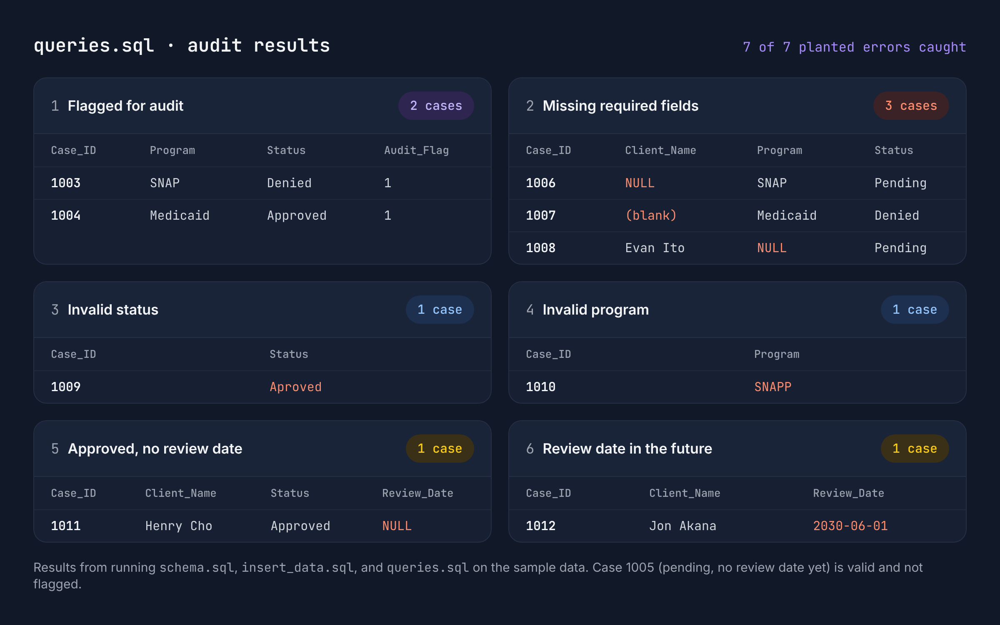

# 📊 Compliance Audit Dashboard

SQL audit queries for checking case records before a compliance review. Built for QA reviewers and auditors who need flagged cases, missing fields, and invalid values pulled into one set of results before records move forward.

A MySQL schema stores the case records, eight queries run the audit and integrity checks, and the results show which records fail each rule, plus case counts by program and status. Every query traces back to a user story in [`REQUIREMENTS.md`](REQUIREMENTS.md).

## 🔍 What It Does

- Stores case records (ID, client, program, status, review date, audit flag) in a relational SQL schema
- Lists all cases flagged for audit
- Flags records missing a client name, program, or status
- Flags invalid status values (anything other than Approved, Pending, or Denied)
- Flags invalid program values (anything other than SNAP, TANF, or Medicaid)
- Flags approved cases with no review date
- Flags review dates set in the future
- Summarizes case counts by program and status, plus a total count of approved cases

## 🧪 Sample Data

[`insert_data.sql`](insert_data.sql) loads 12 records: 5 clean records and 7 with intentional errors (missing or blank names, missing program, misspelled status, invalid program, approved with no review date, and a future review date). Each error is caught by one of the audit queries. A pending case with no review date is included as a valid record and is not flagged.

## 📊 Sample Output

Running the audit queries on the sample data catches all 7 intentional errors. Case 1005 (pending, no review date yet) is valid and not flagged.

## 🧩 Root Cause Analysis

See [`ROOT_CAUSE_ANALYSIS.md`](ROOT_CAUSE_ANALYSIS.md) for why each error type reached the table, a 5 Whys example, and tested prevention controls. [`prevention_controls.sql`](prevention_controls.sql) adds entry rules (NOT NULL, CHECK constraints, and triggers) to a copy of the table. In testing, the controls rejected all 7 error records and accepted all 5 clean records.

## 🧰 Tools Used

- SQL (MySQL, AI-assisted development)
- Database schema design
- Query-based audit and data integrity checks

## 📁 File Overview

- [`schema.sql`](schema.sql) - Creates the database and the case records table (safe to re-run)
- [`insert_data.sql`](insert_data.sql) - Loads a sample dataset with intentional errors
- [`queries.sql`](queries.sql) - Audit, data integrity, and reporting queries
- [`REQUIREMENTS.md`](REQUIREMENTS.md) - Business requirements: scope, data rules, assumptions, user stories, traceability, and success criteria
- [`ROOT_CAUSE_ANALYSIS.md`](ROOT_CAUSE_ANALYSIS.md) - Root causes, 5 Whys, and prevention control test results
- [`prevention_controls.sql`](prevention_controls.sql) - Entry rules to stop each error type, tested against the sample data
- [`images/audit_results.png`](images/audit_results.png) - Screenshot of the audit query results from the sample data

## ▶ How to Use It

1. Run [`schema.sql`](schema.sql) in MySQL to create the database and table
2. Run [`insert_data.sql`](insert_data.sql) to load sample data
3. Run [`queries.sql`](queries.sql) to generate audit results
4. Optional: run [`prevention_controls.sql`](prevention_controls.sql), then copy sample records into `cases_controlled` one at a time to see which ones get rejected

## 📌 Purpose

Built from audit-readiness work in regulated case review, where a missing field or bad status value turns into an audit finding if nobody catches the record first. Running these queries before review puts every failing record in front of the reviewer, listed under the rule each record fails.
